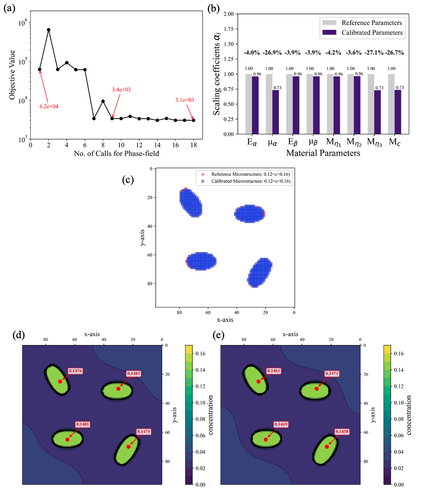

## Inverse problem based on AD‐based sensitivities

On top of JAX-PF package, the pipeline integrates AD-based sensitivity analysis with gradient-based optimization, offering a computationally efficient and accurate method for calibration.

__Case Study__: Calibration of material parameters

<p align="middle">
  
</p>
<p align="middle">
    <em >Gradient-based optimization via differentiable simulations.</em>
</p>


## How to run
Place `phaseField/` in the `applications/` folder of JAX-FEM and run from the JAX-FEM root directory:
```bash
CUDA_VISIBLE_DEVICES=0 python -m applications.phaseField.calibration_precipitation.calibration_implicit_variants
```

## Reference
[1] https://arxiv.org/abs/2601.06079
